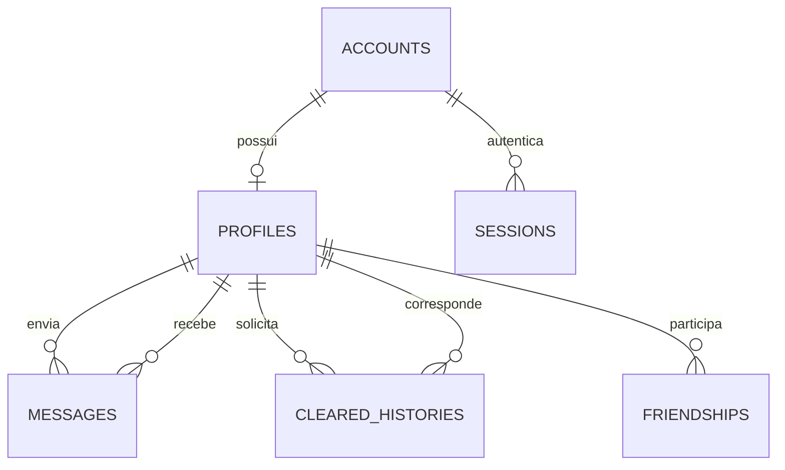

# Banco de dados do YALA 1.0

O banco é SQLite. O [esquema executado pelo servidor](../schema.sql) cria seis
tabelas e ativa a verificação de chaves estrangeiras.

| Tabela | Chave | Dados e relação |
| --- | --- | --- |
| `accounts` | `id` | Nome de usuário único, hash da senha e salt. |
| `profiles` | `account_id` | Chave estrangeira para a conta. Guarda nome, país, universidade, curso e interesses. Cada conta tem até um perfil. |
| `sessions` | `token_hash` | Hash do identificador de sessão, conta associada e vencimento. Cada conta pode ter várias sessões com validade de oito horas. |
| `messages` | `id` | Remetente e destinatário referenciam perfis distintos. Guarda texto e horário de envio. |
| `cleared_histories` | `account_id`, `peer_id` | Identificador da última mensagem excluída do histórico da conta solicitante para aquele contato. |
| `friendships` | `account_a`, `account_b` | Par único de perfis, remetente do convite e situação pendente ou aceita. |

Uma conversa é o conjunto de mensagens entre dois perfis nos dois sentidos.
O índice por remetente, destinatário e identificador apoia a consulta ordenada.
A API usa a conta autenticada para compor o par e autorizar a leitura. Assim, mudar
o identificador do outro perfil seleciona outra conversa da própria conta.

O arquivo padrão é `data/yala.sqlite`. O diretório de dados é ignorado pelo Git.
Datas e vencimentos são armazenados em milissegundos desde a época Unix.

A exclusão individual registra o maior identificador de mensagem já existente
para o par no momento da operação. A consulta retorna apenas mensagens com
identificador maior que esse marco. A consulta da outra conta usa o próprio
marco. A criação da tabela é aditiva e ocorre ao iniciar o servidor.
