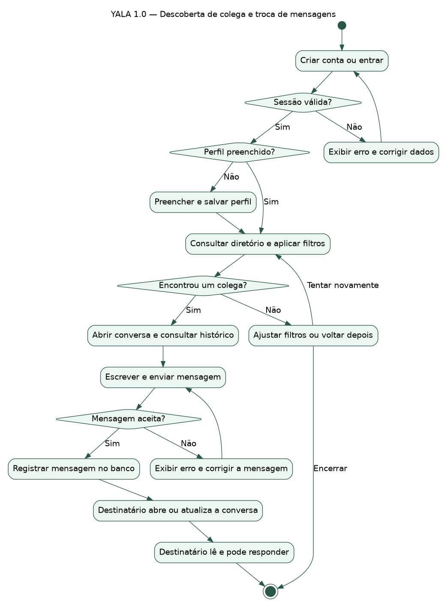

# Diagramas do YALA 1.0

## Casos de uso

O visitante cria uma conta ou entra. O estudante autenticado consulta o diretório
e gerencia seu perfil. Para enviar ou ler mensagens, precisa preencher o perfil.
Uma resposta usa o mesmo caso de uso de envio de mensagem.

## Atividade

O fluxo acompanha a descoberta de um colega até a leitura pelo destinatário.
A conta que recebe a mensagem abre ou atualiza o histórico para consultá-la.

