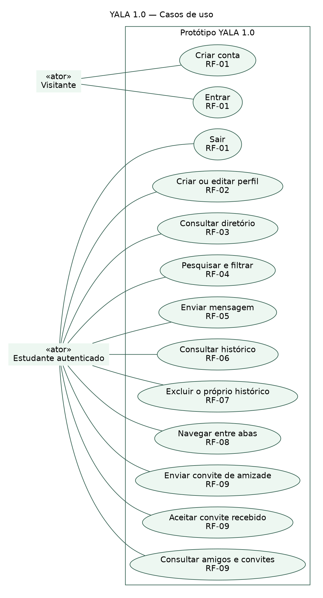

# Diagramas do YALA 1.0

## Casos de uso

O visitante cria uma conta ou entra. Depois de preencher o perfil, a pessoa
pode descobrir colegas, enviar e aceitar convites, consultar a lista de amigos
e trocar mensagens. A exclusão do histórico afeta apenas quem a solicitou.

## Atividade

A partir do diretório, o usuário pode convidar um colega ou abrir uma conversa.
O aceite gera uma amizade visível para as duas contas. O destinatário da
mensagem pode abrir ou atualizar seu histórico, e cada pessoa pode excluir
o próprio histórico.

